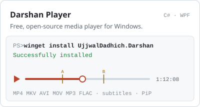
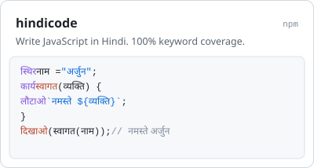
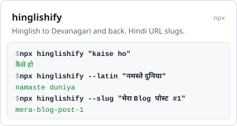
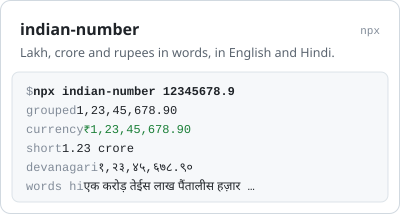
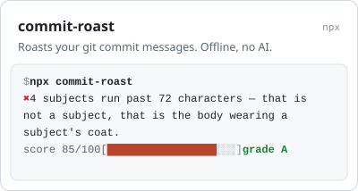
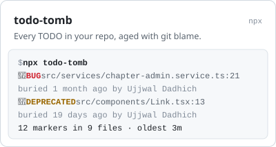
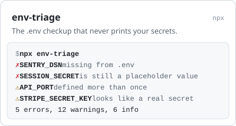
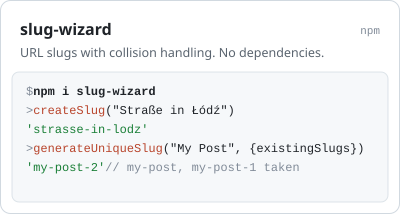

<picture>
  <source media="(prefers-color-scheme: dark)" srcset="assets/header-dark.svg">
  
</picture>

I build products end to end: a reading platform, a media player that ships on winget, and small command-line tools that each do one job well. A lot of it is made for India: JavaScript in Hindi, Hinglish to Devanagari, lakh and crore done right.

<a href="https://chapterchase.com">
  <picture>
    <source media="(prefers-color-scheme: dark)" srcset="assets/chapterchase-dark.svg">
    
  </picture>
</a>

### Made for India

  <a href="https://github.com/Ujjwal-08/DarshanPlayer"><picture><source media="(prefers-color-scheme: dark)" srcset="assets/cards/darshan-player-dark.svg"></picture></a>
  <a href="https://github.com/Ujjwal-08/hindicode"><picture><source media="(prefers-color-scheme: dark)" srcset="assets/cards/hindicode-dark.svg"></picture></a>
  <a href="https://github.com/Ujjwal-08/hinglishify"><picture><source media="(prefers-color-scheme: dark)" srcset="assets/cards/hinglishify-dark.svg"></picture></a>
  <a href="https://github.com/Ujjwal-08/indian-number"><picture><source media="(prefers-color-scheme: dark)" srcset="assets/cards/indian-number-dark.svg"></picture></a>

### Developer tools

Small and dependency-free. The CLIs run with `npx`, nothing to install.

  <a href="https://github.com/Ujjwal-08/commit-roast"><picture><source media="(prefers-color-scheme: dark)" srcset="assets/cards/commit-roast-dark.svg"></picture></a>
  <a href="https://github.com/Ujjwal-08/todo-tomb"><picture><source media="(prefers-color-scheme: dark)" srcset="assets/cards/todo-tomb-dark.svg"></picture></a>
  <a href="https://github.com/Ujjwal-08/env-triage"><picture><source media="(prefers-color-scheme: dark)" srcset="assets/cards/env-triage-dark.svg"></picture></a>
  <a href="https://github.com/Ujjwal-08/slug-wizard"><picture><source media="(prefers-color-scheme: dark)" srcset="assets/cards/slug-wizard-dark.svg"></picture></a>

### Toolbox

`JavaScript` `TypeScript` `Node.js` `Bun` `Qwik` `React Native` `Expo` `C#` `.NET` `WPF` `MySQL` `Redis` `Docker` `Cloudflare`

### Get in touch

**Me:** [ujjwaldadhich08@gmail.com](mailto:ujjwaldadhich08@gmail.com) 
**ChapterChase support:** [help@chapterchase.com](mailto:help@chapterchase.com)

[chapterchase.com](https://chapterchase.com) · [npm](https://www.npmjs.com/~ujjwaldadhich) · [Darshan Player on winget](https://github.com/microsoft/winget-pkgs/tree/master/manifests/u/UjjwalDadhich/Darshan)
